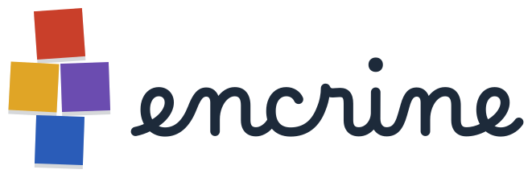

<p align="center">
  <a href="https://encrine.ai"><picture>
    <source media="(prefers-color-scheme: dark)" srcset="assets/logo-encrine-craie.svg">
    
  </picture></a>
</p>

<p align="center">
  <strong>Case après case, votre année de classe.</strong><br>
  <a href="https://encrine.ai">encrine.ai</a> ·
  <a href="https://github.com/encrine-ai/moteur">Le moteur</a> ·
  <a href="https://encrine.ai/tour-du-monde/">La classe d’exemple</a> ·
  <a href="https://encrine.ai/design/">Design system</a>
</p>

# La page d'accueil d'Encrine

Ce dépôt est le site **https://encrine.ai**, publié par GitHub Pages : il explique le principe, guide l'enseignant qui veut créer sa classe, et montre « Les classes » que des enseignants ont choisi de partager. Une classe acceptée dans la galerie est **copiée** dans l'organisation, au commit relu (`encrine-ai/<id>`), et servie sur `https://encrine.ai/<id>/` ; sa classe continue de vivre dans le dépôt de son auteur, qui peut la retirer de la galerie à tout moment.

Site statique, sans étape de fabrication : `index.html`, `styles.css`, `site.js` (le script commun aux pages : l'en-tête, le menu du téléphone, le panneau, la galerie), `classes.json` (les classes partagées), les trois pages `contact/`, `mentions-legales/` et `confidentialite/`, la page `design/` (le design system), `assets/` (logos ; `icone-onglet.svg`, l'icône d'onglet, les trois cases sans fond ; `icone-encrine.svg`, la même sur fond ardoise, pour `apple-touch-icon`, où un fond est obligatoire), `fonts/` (Marelle, Unbounded et Figtree, toutes servies par le site : aucune requête vers un service tiers, ce que la page Confidentialité affirme), `outils/` (la relecture des classes proposées et la frontière classe / moteur de leurs copies, dont se sert l'agent galerie ; sa procédure, `relire-classe`, vit dans [`encrine-ai/agents`](https://github.com/encrine-ai/agents)), `.github/ISSUE_TEMPLATE/` (les formulaires « Proposer ma classe » et « Signaler une classe »), `AGENTS.md` (les consignes des agents ; `CLAUDE.md` l'importe). Ceux-là, et ce README, ne sont pas publiés : le workflow les retire du site. Le style suit le design system Encrine, « Le parcours ».

## Mettre en ligne

1. Pousser ces fichiers à la racine du dépôt `encrine-ai.github.io` de l'organisation, branche `main`.
2. Dans les réglages du dépôt, *Pages* : source « GitHub Actions ». Le workflow `.github/workflows/pages.yml` publie à chaque poussée sur `main` les fichiers versionnés, **sans** `outils/`, `.agents/`, `.claude/`, `.github/`, `AGENTS.md`, `CLAUDE.md` ni ce `README.md` (ils ne servent qu'au dépôt).
3. Le fichier `CNAME` contient `encrine.ai`. Chez le registraire du domaine, créer :
   - pour `encrine.ai` (domaine nu) quatre enregistrements `A` vers `185.199.108.153`, `185.199.109.153`, `185.199.110.153`, `185.199.111.153` (et, si possible, les `AAAA` `2606:50c0:8000::153` à `2606:50c0:8003::153`) ;
   - pour `www.encrine.ai` un `CNAME` vers `encrine-ai.github.io`.
4. Une fois le domaine vérifié par GitHub, cocher *Enforce HTTPS*.

Comme pour Ludea, le domaine n'est déclaré qu'une fois, sur ce dépôt : les autres dépôts Pages de l'organisation sont alors servis à `encrine.ai/<dépôt>/` sans réglage supplémentaire — la classe d'exemple (`encrine-ai/tour-du-monde`) et chaque copie relue de la galerie (`encrine-ai/<id>`). Un `id` de la galerie ne doit donc jamais reprendre le nom d'un dossier de ce site.

## Les sections de la page

Dans l’ordre : l’en-tête (le logo, le menu, GitHub), le héros, « Sur cette page » (le sommaire), Comment ça marche (les deux façons de commencer, puis les questions de l’entretien), Ce que vous recevez (neuf cases, chacune avec « Le détail » qui se déplie), Vos retours, Les classes (la galerie), Sous le capot (les quatorze skills du moteur), Les contrôles, Ce qui est prêt, l’appel final, le pied de page (les liens vers les trois autres pages).

Chaque chose ne se dit qu’à un endroit. Les garanties (le programme couvert, une page par fiche, le choix des photos, les licences, les skills mesurés) ne se détaillent que dans Les contrôles ; ailleurs, un renvoi « voir Les contrôles ». La boucle des retours et la mise à jour du moteur vivent dans Vos retours, le partage dans Les classes : les cartes des skills correspondants, dans Sous le capot, y renvoient sans les répéter. L’ancre `#fonctionnalites` reste valable : elle mène à Ce que vous recevez.

Ce que vous recevez, Sous le capot et Les contrôles décrivent le moteur (`encrine-ai/moteur`) : chaque phrase y a été vérifiée dans son `README.md`, ses skills (`.claude/skills/*/SKILL.md`) et ses scripts. Quand le moteur change (un skill ajouté, un contrôle nouveau), ces trois sections se mettent à jour avec lui ; une chose prévue mais pas prête n’y entre pas. Les chiffres sont ceux du moteur, jamais ceux d’une classe (159 : les attendus de la liste de Grande Section, `referentiel/cycle1-gs.yml`).

## L'aperçu de lien

Les cinq pages portent, sous leur `<meta name="description">`, les balises Open Graph et Twitter que lisent les messageries et les réseaux (qui n'exécutent pas le JavaScript) : titre et description propres à chaque page, `og:url` et `og:image` en **adresses absolues** (`https://encrine.ai/…`), et `<link rel="canonical">`. Une page ajoutée les reçoit aussi, avec sa propre description.

L'image, `assets/partage.png` (1200 × 630), se fabrique depuis `assets/partage.html` (le logo, le titre en Unbounded, la marelle du héros recopiée, sur la craie et l'ardoise) : une capture Playwright à 1200 × 630 en thème clair, puis une palette de 128 couleurs (Pillow) — une trentaine de Ko. Elle doit rester lisible réduite à 300 px de large, la taille d'un aperçu sur téléphone : le titre seul doit s'y lire. Si le héros ou le titre changent, refaire l'image.

## L'en-tête et le menu

L'en-tête est **toujours visible** (`position: sticky`) sur les cinq pages. Une fois la page descendue, `site.js` lui pose la classe `entete--descendu` : un filet fin en bas, et il se resserre sans que rien ne saute (sa boîte garde `--entete-haut`, il remonte de `--entete-retrait` sous le bord de l'écran, le logo rapetisse ; pas d'animation si l'appareil demande moins de mouvement). Les ancres placent leurs titres juste dessous (`scroll-margin-top`, calculé sur ces deux valeurs). Le lien d'évitement « Aller au contenu » et les panneaux `<dialog>` passent au-dessus.

Sous 1100 px (téléphone et tablette), l'en-tête ne garde que le logo et le bouton « Menu » (un burger), et il garde sa taille en défilant : seuls le filet et le fond apparaissent. Le bouton, posé par `site.js`, ouvre un panneau qui reprend en liste sobre le sommaire de l'accueil (la liste `SECTIONS` de `site.js`, à tenir alignée sur le sommaire de `index.html`), puis « Créer ma classe » et GitHub. Le sommaire en cases du haut de l'accueil s'efface alors (le menu fait le même travail), et la marelle du héros passe en filigrane derrière le texte (contraste du texte mesuré au-dessus de 4,5:1). Sur les autres pages, les liens du menu mènent à l'accueil (`../#…`).

## La page Design system

`design/index.html` : le style de la marque (le logo, les couleurs, les polices, les espaces et les formes, les composants, le ton). Elle montre les **vrais** composants, avec les classes de `styles.css` (les règles `ds-…` ne servent qu'à ses planches), et son script relit `styles.css`, les SVG d'`assets/` et les licences de `fonts/` pour écrire les valeurs : un code de couleur, une graisse, un angle ne s'y recopient jamais à la main. Un composant ajouté à l'accueil s'y ajoute ; le panneau `<dialog id="partir">` y est recopié, à aligner sur celui de l'accueil.

## Les autres pages

Trois pages de texte, avec le même en-tête et le même pied que l'accueil, et `styles.css` (les règles `.texte`) :

- `contact/` : hello@encrine.ai ; un problème dans une classe de la galerie, le mode retours pour l'enseignant qui a sa classe, le moteur et ses issues pour les développeurs ;
- `mentions-legales/` : l'éditeur (NORRECRAFT), le directeur de la publication, l'hébergeur (GitHub Pages), la propriété intellectuelle, le signalement d'un contenu ;
- `confidentialite/` : la politique de confidentialité (RGPD). Elle affirme que le site n'a ni compte, ni formulaire, ni cookie, ni mesure d'audience, ni publicité, ni service tiers : tout ajout d'un script, d'une police ou d'un outil extérieur doit d'abord la mettre à jour.

Le pied de page (Contact · Mentions légales · Confidentialité · Design system · GitHub · © 2026 Encrine) et l'en-tête sont recopiés dans les cinq pages : une modification se fait partout. Dans les trois pages, « Créer ma classe » mène à `../#creer`, qui ouvre le panneau sur l'accueil.

## Les adresses à tenir à jour

En haut de `site.js`, l'objet `LIENS` porte le propriétaire et le nom du dépôt modèle (`encrine-ai` / `moteur`), le nom de ce dépôt (`encrine-ai.github.io`, pour « Signaler une classe », qui ouvre ici le formulaire `signaler-une-classe.yml`) et l'adresse de la classe d'exemple, la démonstration, une classe à part (`encrine-ai/tour-du-monde`) (`https://encrine.ai/tour-du-monde/`). Les liens de la page sont réécrits depuis cet objet ; les adresses écrites en dur dans le HTML ne servent qu'aux navigateurs sans JavaScript, à aligner si l'on change l'objet.

## Les classes : `classes.json`

La section « Les classes » est une galerie construite à partir de `classes.json`. La classe d’exemple (`"exemple": true`) vient toujours en premier, avec le badge « Classe d’exemple » ; les classes partagées suivent. Seules les cartes publiées se montrent (`etat` absent ou `"publiee"`). Chaque carte prend les couleurs **de son thème** (la frise de ses milieux), jamais celles d'Encrine, crédite son auteur (« Par <auteur> », lien vers son dépôt, et vers son site s'il est donné) et propose deux actions : « Voir la classe » (la copie relue, `https://encrine.ai/<id>/`) et « Partir de cette classe ». Les deux voies passent par le même panneau (`<dialog id="partir">`, un seul pour toute la page, rempli selon le bouton qui l'ouvre ; Échap pour fermer, le focus revient au bouton) :

- **« Créer ma classe »** (en-tête, haut de page, appel final) l'ouvre pour le modèle `moteur`, « Créer votre classe » : créer son dépôt depuis le modèle (lien construit depuis `LIENS`), activer le site (*Settings* → *Pages* → *Source* : *GitHub Actions*), puis taper `/nouvelle-classe` dans Claude Code, avec un bouton « Copier ». Sans JavaScript, le bouton reste un lien direct vers le modèle sur GitHub.
- **« Partir de cette classe »** l'ouvre pour la carte. La copie relue de chaque classe partagée est un modèle GitHub : on crée son dépôt depuis **elle** (`github.com/new?template_owner=encrine-ai&template_name=<id>`, tiré du champ `depot`), on active le site, puis on tape `/nouvelle-classe`, sans adresse : l'agent voit de quelle classe il part (le `depot` de son `classe.yml`, resté celui de l'enseignant d'origine), annonce ce qu'il garde et crédite cet enseignant (`origine`).

Avec un `apercu`, la carte prend toute la ligne : la capture de l'accueil du site sur un ordinateur, le téléphone posé devant, puis la fiche de la classe et la mention « S'installe comme une appli », qui renvoie au bloc `#appli` de l'accueil. Les captures se font sur la copie en ligne, avec Playwright, à 1280 × 800 et à 390 × 844, sans l'invitation à installer (poser avant le chargement la clé `localStorage` `encrine-invitation:/<id>/` à `fermee`) et sans service worker (`serviceWorkers: 'block'`) ; le site ne doit plus afficher « Chargement… ». Les chemins des images partent de la racine de ce site.

Le bouton « Partir de cette classe » n'apparaît que si la fiche a un `depot` et une licence qui permet la reprise : CC0, CC BY ou CC BY-SA (ni NC, ni ND). La copie est alors marquée *Template repository*.

Les noms des champs sont ceux de la fiche qu'écrit le skill `partager-ma-classe` du moteur (`titre`, `niveau`, `annee`, `zone`, `auteur`, `licence`, `licence_note`, `accroche`, `semaines`, `milieux`, `site`, `depot`, `verifie`, `partagee_le`) ; la galerie les relit, et y ajoute ce qui tient à la copie (`copie`, `source`, `verifie.commit`, `acceptee_le`, `demande`, `etat`). `site` et `depot` y désignent **la copie**, et non plus le site et le dépôt de l'enseignant (`source`, `source_site`).

```json
{
  "version": 1,
  "classes": [
    {
      "id": "il-etait-une-fois",                          // unique, minuscules et tirets : le nom de la copie (encrine-ai/<id>) et le chemin de son site
      "exemple": false,                                   // facultatif : true pour la classe d'exemple d'Encrine, montrée en premier
      "etat": "publiee",                                  // publiee | retiree ; seule une carte publiée se montre
      "titre": "Il était une fois",                       // le projet de la classe
      "niveau": "CP",
      "annee": "2027-2028",
      "zone": "B",
      "accroche": "Un conte par période…",                // facultatif : une ou deux phrases sur la classe
      "apercu": {                                         // facultatif : l'accueil de la copie, en captures (WebP, moins de 150 Ko chacune, dans assets/classes/)
        "ordinateur": "assets/classes/il-etait-une-fois-ordinateur.webp",  // 1280 × 800
        "telephone": "assets/classes/il-etait-une-fois-telephone.webp",    // 390 × 844
        "alt": "L'accueil du site « Il était une fois » : …"              // ce que montre la capture
      },
      "icone": "assets/classes/il-etait-une-fois-icone.png", // facultatif : l'icône d'appli de la classe, montrée en petit à côté du titre
      "semaines": 36,                                     // facultatif : les semaines de classe de l'année, dans sa zone (la somme des milieux)
      "milieux": [ { "nom": "les contes de randonnée", "couleur": "#7a4b9c", "semaines": 7 } ],  // une entrée par période, couleur du thème, semaines dans la zone
      "auteur": "M. Martin",                              // nom ou pseudonyme, au choix de l'auteur ; « Par M. Martin » sur la carte
      "licence": "CC BY-SA 4.0",                          // CC0, CC BY ou CC BY-SA pour que la classe puisse être reprise
      "licence_note": "sauf les pictogrammes ARASAAC, sous leur propre licence",  // facultatif : les exceptions
      "site": "https://encrine.ai/il-etait-une-fois/",    // la copie relue (« Voir la classe »)
      "depot": "encrine-ai/il-etait-une-fois",            // la copie, marquée Template repository (« Partir de cette classe ») ; lu par l'agent moteur pour la tenir à jour ; absent d'une carte retirée
      "copie": "encrine-ai/il-etait-une-fois",            // la copie (reste quand depot part, au retrait)
      "source": "martin/il-etait-une-fois",               // le dépôt de l'enseignant : « Par <auteur> » y mène
      "source_site": "https://martin.github.io/il-etait-une-fois/",  // facultatif : le site de l'enseignant, lien « son site »
      "origine": { "depot": "…", "titre": "…", "auteur": "…" },     // facultatif : la classe d'où celle-ci est partie
      "verifie": { "attendus": "120/120", "pdf": 140, "pagination": true, "le": "2027-09-20", "commit": "<sha relu, 40 caractères>" },  // ce que la galerie a contrôlé, et le commit relu que sert la copie
      "partagee_le": "2027-09-19",                        // le jour où l'enseignant l'a proposée
      "acceptee_le": "2027-09-21",                        // le jour où le propriétaire de la galerie l'a acceptée
      "mise_a_jour_le": "2027-11-02",                     // facultatif : la dernière mise à jour relue appliquée
      "demande": "https://github.com/encrine-ai/encrine-ai.github.io/issues/12"  // la demande (issue) appliquée en dernier
    }
  ]
}
```

(Exemple fictif ; les commentaires ne sont qu'explicatifs : le fichier est du JSON strict. Aujourd'hui la liste ne contient que la classe d'exemple, « Le tour du monde », qui est déjà une classe de l'organisation : sa copie est elle-même (`copie` = `source` = `depot` = `encrine-ai/tour-du-monde`), sans demande ni date d'acceptation (`null`), et `verifie` n'y porte que le commit publié ; sous sa carte, un message dit que les premières classes partagées apparaîtront ici.)

Une carte retirée garde une ligne courte, pour l'histoire et pour que la vérification de nuit s'assure que la copie a bien été supprimée : `id`, `"etat": "retiree"`, `copie`, `source`, `verifie.commit`, `acceptee_le`, `retiree_le`, `raison` (`auteur`, `securite`, `proprietaire`), `demande`, et `supprimee_le` une fois le dépôt de la copie supprimé — ni titre, ni auteur, ni aperçu, ni `depot`.

### Ajouter une classe

1. L'enseignant le demande dans sa classe : le skill `partager-ma-classe` du moteur vérifie que l'année couvre le programme, que les PDF sont fabriqués et paginés, que chaque image et chaque texte a une licence qui permet le partage, et qu'aucune donnée d'élève n'y figure ; il prépare la fiche.
2. Il ouvre ici une **issue « Proposer ma classe »** (le formulaire `.github/ISSUE_TEMPLATE/proposer-ma-classe.yml`, prérempli : `issues/new?template=proposer-ma-classe.yml&classe=…&site=…&commit=…&marque=…&fiche=…&controles=…`), qui porte la marque `<!-- partage v1 genre=ajout classe=<propriétaire/dépôt> commit=<sha> moteur=<version> -->`, la fiche, et le **consentement** de l'auteur : Encrine héberge une copie relue, la montre avec son nom d'auteur, et d'autres en partent selon sa licence.
3. L'agent galerie la relit (chaque nuit, selon sa procédure `relire-classe`, dans `encrine-ai/agents`) : au commit exact, avec les outils de confiance du moteur et `outils/`, sans jamais exécuter son code ; un relecteur indépendant regarde chaque texte et chaque image. Le propriétaire de ce dépôt accepte ; l'agent **copie** la classe dans l'organisation au commit relu (`encrine-ai/<id>`, avec le moteur d'Encrine), allume son site sur `https://encrine.ai/<id>/`, la marque *Template repository* si la licence le permet, puis écrit la carte dans `classes.json`.

Une **mise à jour** (`genre=mise-a-jour`) se relit sur ce qui a changé depuis `verifie.commit`, puis, acceptée, s'applique sur la copie (le contenu seul : la copie garde le moteur d'Encrine). Le dépôt de l'enseignant n'est jamais touché, et la galerie ne le surveille pas : la copie ne change que par une mise à jour relue.

### Retirer une classe

L'auteur le demande (`genre=retrait`, ou « Signaler une classe » → « I am the author ») : la carte passe à `"etat": "retiree"` et le site de la copie est coupé, sans discussion. « Signaler une classe » ouvre ici le formulaire `.github/ISSUE_TEMPLATE/signaler-une-classe.yml` ; un problème de sécurité signalé retire la carte et coupe la copie aussitôt (skill `relire-classe`). Puis la copie est **supprimée**, par le propriétaire (un agent ne supprime jamais un dépôt) : l'agent lui donne le jour même le lien (*Settings* → *Danger Zone* → *Delete this repository* de `encrine-ai/<id>`), et vérifie la nuit suivante que c'est fait.

Le pied du site de chaque copie porte le lien « Mentions légales » d'Encrine, posé par le moteur : c'est Encrine qui publie la copie.

## Licences

Marelle, Unbounded et Figtree sont sous SIL Open Font License 1.1 (`fonts/LICENCE-Marelle.txt`, `fonts/LICENCE-Unbounded.txt`, `fonts/LICENCE-Figtree.txt`). Unbounded et Figtree sont les fichiers de Google Fonts (sous-ensembles latin et latin étendu), copiés dans `fonts/`. Le nom « encrine » du logo est tracé depuis Marelle.
